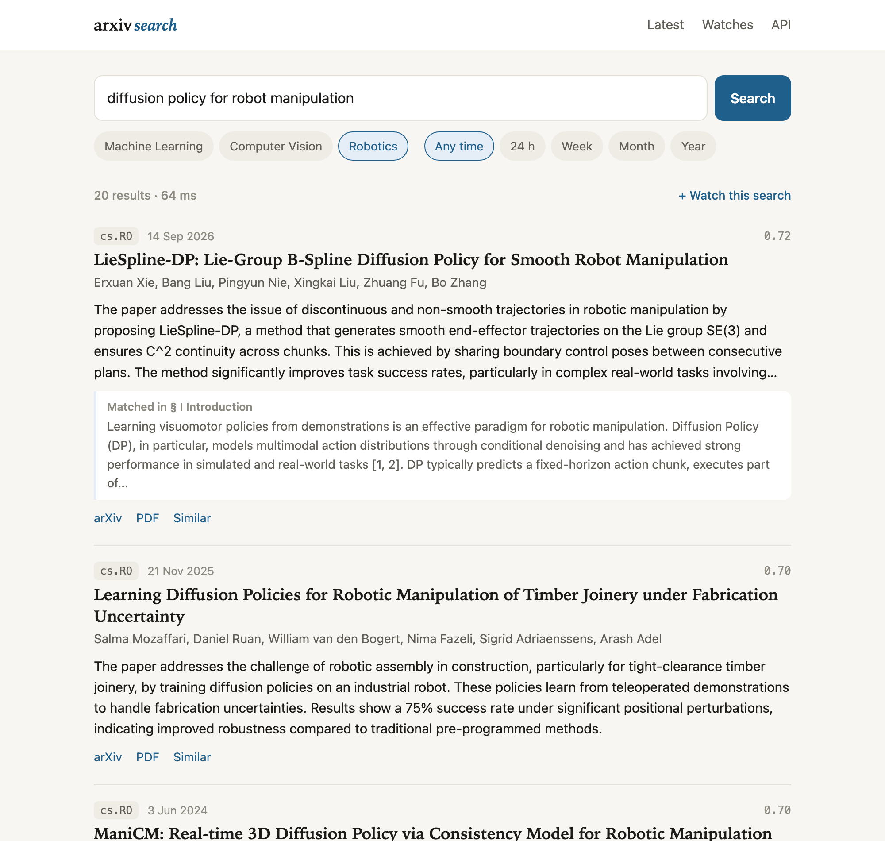
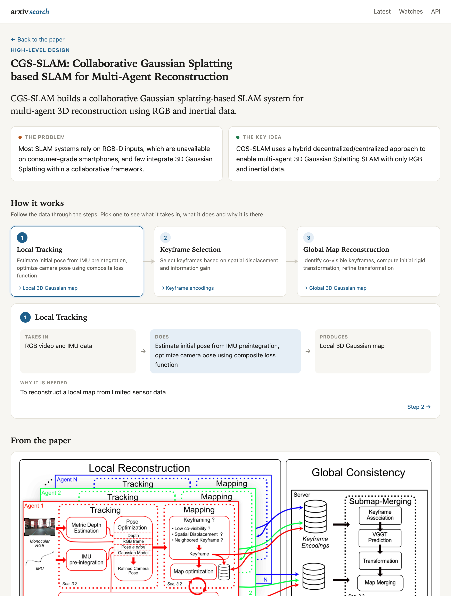
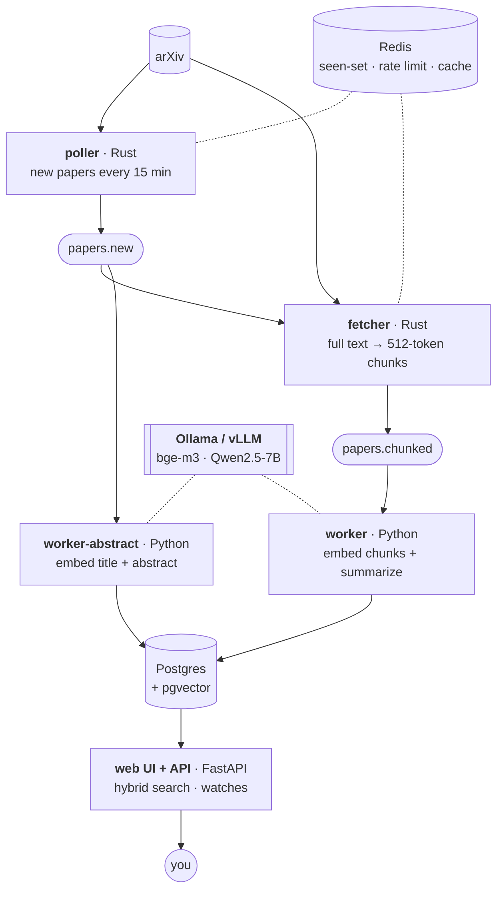

# arXiv Ingestion Engine

[](https://github.com/vedanthchamala/arxiv-ingestion-engine/actions/workflows/ci.yml)

A self-hosted search engine for new arXiv papers. It watches the machine learning, computer vision and
robotics categories, pulls each paper's full text, summarizes it with a local model, and gives you a web
page to search everything by meaning, by name or by author. Saved searches tell you what's new each
morning.



## What you get

- **Search that understands topics and names.** "diffusion policy for robot manipulation" finds papers
  that never use those exact words, and `CGS-SLAM` finds the CGS-SLAM paper rather than its lookalikes.
  Each result shows the passage that matched and a short summary.
- **A latest-papers feed** filtered by category, with a page per paper: summary, abstract, indexed
  sections and similar papers.
- **High-level design for any paper.** One click turns a paper into a visual walkthrough: what it
  builds, the problem and key idea, the method as a clickable flow of steps, the paper's own
  architecture figure, results and key terms. Numbers and terms are checked against the paper's text.
- **Watches.** Save any search and see the papers that arrived since your last visit, or subscribe to
  its Atom feed in any feed reader.
- **Everything local.** Embeddings and summaries come from Ollama on your machine (or vLLM on a GPU
  box), and no paper text leaves it.

<details>
<summary>The High-level design page of a paper</summary>



</details>

## Quickstart

You need [Docker](https://docs.docker.com/get-docker/) and [Ollama](https://ollama.com/download), both
running.

```bash
git clone https://github.com/vedanthchamala/arxiv-ingestion-engine.git
cd arxiv-ingestion-engine
scripts/quickstart.sh            # add --no-summaries to skip the 4.7 GB summary model
```

Then open **http://localhost:8000**. The first poll collects the ~2,000 newest papers in each category.
They're searchable by title and abstract within about ten minutes. Full text and summaries follow over
the next few hours, because arXiv allows one request every three seconds.

```bash
docker compose --profile pipeline logs -f poller worker   # follow progress
docker compose --profile pipeline stop                    # stop; your data stays in Docker volumes
scripts/quickstart.sh                                     # start again (also rebuilds after a git pull)
```

## Architecture



1. The **poller** asks arXiv for each category's newest papers and stops at the ones it has already
   seen (a Redis set). Each new paper becomes one message on `papers.new`.
2. The **fast path** (`worker-abstract`) embeds the title and abstract and writes the paper to Postgres.
   From that moment the paper is searchable.
3. The **fetcher**, the only process that downloads from arxiv.org, gets the full text. It tries the
   HTML version first (real section headings) and falls back to the PDF. It then splits the text into
   512-token chunks with the embedding model's own tokenizer.
4. The **worker** embeds every chunk, writes a 2–3 sentence summary, and replaces the abstract-only row
   in one transaction.
5. **Search** blends vector similarity over the chunks with keyword matching on titles and abstracts,
   keeps the best passage per paper, and caches answers in Redis. Paraphrases of a recent query come
   straight from the cache.

Delivery is at-least-once and every write is an upsert, so replays and duplicates are harmless.
Messages that keep failing land on `papers.failed` with their original payload, and
`scripts/replay_dlq.py` puts them back. One shared Redis budget keeps every arXiv-facing process,
together, under arXiv's limit of one request per three seconds.

## Using it

| Page | What it does |
|---|---|
| `/` | Latest papers; type in the box to search. Paste an arXiv id or URL to jump straight to that paper |
| `/paper/{id}` | Summary, abstract, indexed sections, similar papers |
| `/paper/{id}/design` | High-level design: the method as a flow of steps, the overview figure, results, terms |
| `/author?name=…` | One author's papers in the index |
| `/watches` | Saved searches with what's new since your last visit; each has an Atom feed |
| `/docs` | The JSON API (`POST /search`, `/papers/{id}`, `/papers/{id}/similar`, `/papers/{id}/design`, `/stats`) |

```bash
curl -s localhost:8000/search -H 'content-type: application/json' \
     -d '{"query": "tactile sensing for dexterous grasping", "k": 5, "categories": ["cs.RO"]}'
```

## Configuration

Settings come from the environment or `.env` (see [`.env.example`](.env.example)). The ones you're most
likely to change:

| Variable | Default | Meaning |
|---|---|---|
| `ARXIV_CATEGORIES` | `cs.LG,cs.CV,cs.RO` | Categories to follow |
| `EMBEDDING_URL`, `LLM_URL` | host Ollama | Any OpenAI-compatible server, e.g. vLLM on a GPU box |
| `SUMMARY_ENABLED` | `true` | Turn LLM summaries off |
| `HYBRID_SEARCH` | `true` | Keyword + vector ranking; `false` for vector only |
| `WATCH_MIN_SCORE` | `0.55` | How similar a paper must be to count as a watch match |
| `ANTHROPIC_API_KEY` | unset | Optional: Claude writes the design pages too (a few cents per paper, cached) |
| `API_PORT` | `8000` | Port for the web UI and API |

## Operating it

- **Laptop was off for days?** The poller logs a warning when it can't reach back far enough. Fill
  the gap through arXiv's bulk interface, starting from the day of your newest paper (needs
  [uv](https://docs.astral.sh/uv/)): `uv run --project python python scripts/backfill.py --from 2026-09-17`
- **Browse without polling arXiv:** `scripts/quickstart.sh --no-ingest`
- **Dashboards:** `docker compose --profile observability up -d` adds Prometheus (:9090) and Grafana
  (:3000) with a provisioned pipeline dashboard.
- **Developing:** `scripts/dev.sh` starts only the infrastructure. `scripts/run.sh start` then runs the
  five services on the host from source, with logs in `data/logs/`.

Tests: `cd rust && cargo test` and `cd python && uv run pytest`. `scripts/smoke.sh` checks a running
stack end to end.

## Results

- Ran unattended for four days on a laptop (211 poll cycles, no crashes) and indexed 10,394 papers
  as 309,408 passages, 10,268 of the papers with full text.
- Searches take about 15 ms in Postgres and 35–65 ms end to end, including embedding the query.
- Hybrid search finds a paper from its coined name alone 99.7 % of the time in the top 10, up from
  91.7 % with vectors only, without losing anything on topical queries.
- Survived `kill -9` mid-message with no lost, duplicated or orphaned rows.

## More

[`DECISIONS.md`](DECISIONS.md) records why each part is built the way it is.
[`BENCHMARKS.md`](BENCHMARKS.md) has the measurements and how to reproduce them.
[`STATUS.md`](STATUS.md) is the build and live-run log, and [`SPEC.md`](SPEC.md) the design.

Thank you to arXiv for use of its open access interoperability. This project links to papers on arXiv
and never redistributes their PDFs.
